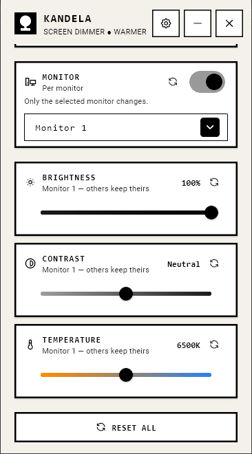
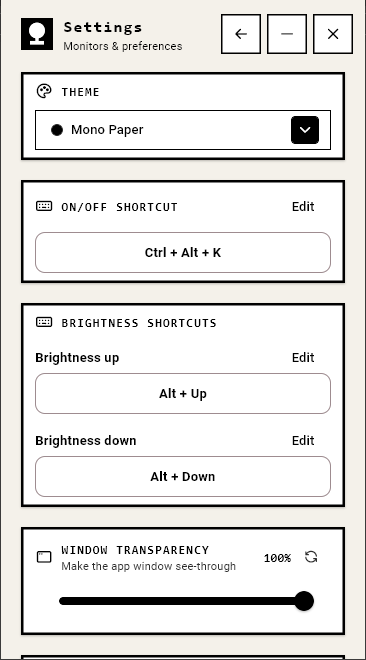

  

<h1 align="center">Kandela</h1>

  <b>Per-monitor screen dimmer &amp; warmer for Windows</b> 
  Soften your screens the way a lamp softens a room.

---

Kandela dims, warms, and tunes every monitor individually — right from your system tray. Built for late-night work, dual-monitor setups, and anyone whose eyes deserve a break.

## Screenshots

  
  &nbsp;&nbsp;
  

## What Kandela does

- **Dim each monitor** — independent brightness per display
- **Warm the color** — night-friendly color temperature
- **Tune contrast** — sharpen or soften the picture
- **Hardware brightness (DDC/CI)** — real backlight control where supported
- **Schedule it** — auto on/off by time of day
- **Keyboard shortcuts** — toggle the effect, step brightness
- **Window transparency** — make the app window see-through (Premium)
- **Automatic update checks** — MSIX via Microsoft Store, EXE via GitHub releases
- **20 retro themes** — from Amber CRT to Game Boy

## Free vs Premium

| | Free | Premium |
|---|:---:|:---:|
| Brightness & contrast | ✅ | ✅ |
| 2 themes | ✅ | ✅ |
| Check for updates | ✅ | ✅ |
| Color temperature | — | ✅ |
| Custom shortcuts | — | ✅ |
| Scheduling | — | ✅ |
| Window transparency | — | ✅ |
| All 20 themes | — | ✅ |

Premium is a **one-time purchase** — no subscription.

## Download

Kandela is a Windows app (x64).

- **Microsoft Store** — [download from the Microsoft Store](https://apps.microsoft.com/detail/9NGMHCTMRMN7) or search "Kandela".
- **Direct download (EXE)** — get `Kandela-Setup-1.0.9.exe` from the [latest release](https://github.com/avrealmop/kandela-docs/releases/latest).

## Documentation

- [Installation](install.md)
- [Features](features.md)

## License

All rights reserved. © Avrealmop.
